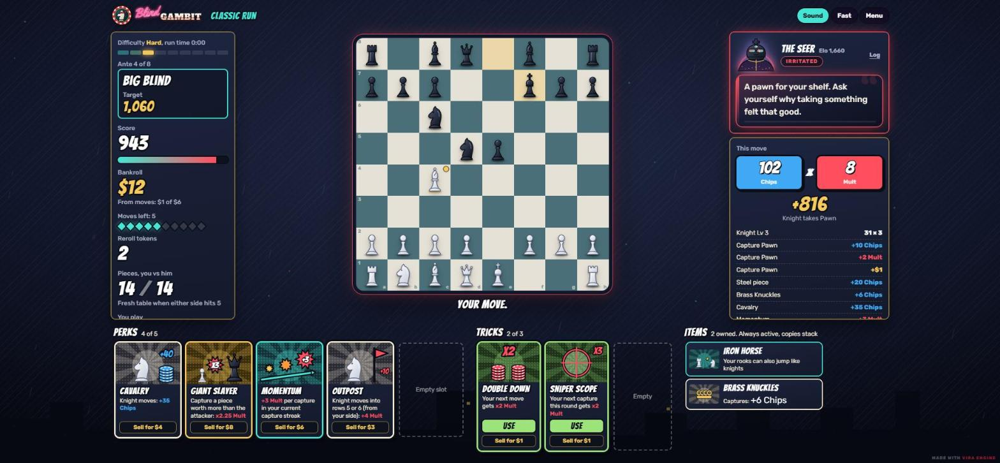
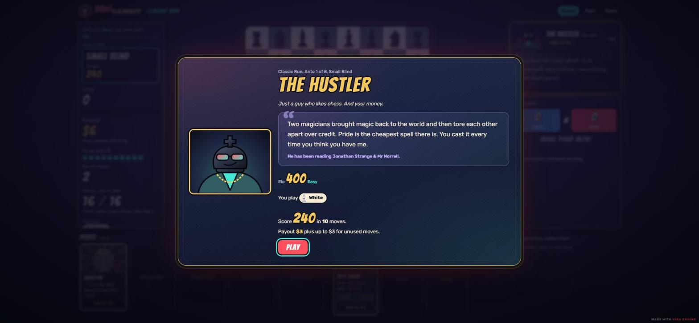
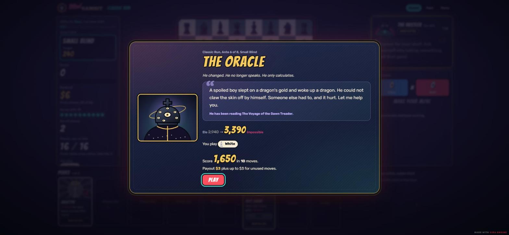
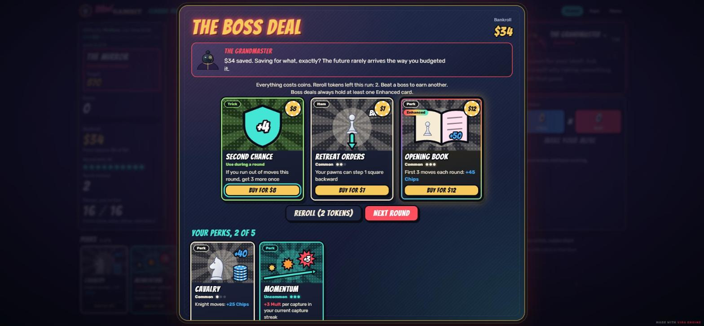
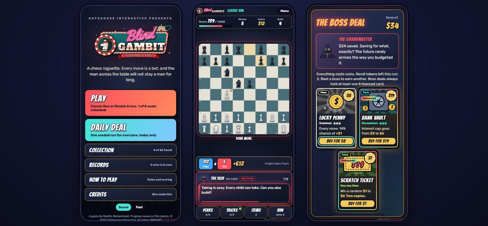

  

  A chess roguelike where every move is a bet. 
  <a href="https://wagner47.github.io/Blind-Gambit/"><b>Play it free in your browser</b></a>

  

## How it plays

You play real chess against one opponent, but each round is a score challenge. Every move scores Chips × Mult. The piece you move sets the base, and captures, checks, promotions and anything you've bought add to it. Reach the round's target before your moves run out. Checkmating him also wins the round. In a Classic Run, missing a target or getting checkmated ends the run.

Between rounds you spend your coins in the Deal: perks that change how moves score, items that stack, one-use tricks, and upgrades for a piece type.

Your opponent changes every ante, eight forms in all. He starts as The Hustler, a weak player with a lot to say, and plays stronger chess every round after that.

<table>
  <tr>
    <td></td>
    <td></td>
  </tr>
  <tr>
    <td align="center">Ante 1</td>
    <td align="center">Ante 6</td>
  </tr>
</table>

## What's in it

- **Classic Run.** 8 antes of 3 blinds. The board carries over from one round to the next. When either side is down to 5 pieces, the table resets and you switch colors.
- **Double Cross.** One game played to checkmate, in hands of 6 moves. After each hand you take over the side you were just playing against.
- 36 perks, 34 items and 12 tricks. Perks and items roll their own numbers each time they show up, and some come Enhanced.
- 14 of the items change how your pieces move: pawns that step sideways, rooks that jump like knights, a queen that can make a knight's move too.
- 8 bosses that each change one rule for their round, 8 starting setups (seats) with 7 to unlock, and 5 heat levels for harder runs.
- The Daily Deal: the same seeded run for everyone, once a day.
- He keeps track of you. He comments on how you play, asks questions in the middle of a game, remembers your answers from one run to the next, and calls it out when your play doesn't match what you told him.

  

## On a phone

The table fits on one screen, with your perks, tricks and items one tap away.

  

## Controls

- Tap or click a square one of your pieces can reach and it moves there. If two pieces can reach it, tap the one you want.
- Tap a piece first to see what each square would score.
- When he asks a question, tap an answer or press 1, 2 or 3.
- Tap his dialogue to skip ahead. Log shows what he has said.

## Notes

- Runs in a modern browser on desktop or phone. No install, no account.
- Your progress is saved in that browser on that device. Clearing site data resets it.
- The whole game is one HTML file, `index.html`.

## Credits

A game by Ramtin Mohammadi. 
Published by Gatehouse Interactive. 
Made with Vira Engine.

His lines are original writing, inspired by thirty classic stories and by Epictetus, Seneca, Marcus Aurelius, Heraclitus, Socrates, Lao Tzu, Pascal, Kierkegaard and Saadi.

Fonts: Bangers, Rubik, Shrikhand, Yellowtail, Alfa Slab One and Bebas Neue, all under the SIL Open Font License.

## License

© 2026 Gatehouse Interactive. All rights reserved.

You're welcome to play the game and share the link. Please don't copy, redistribute or reuse the code, art or writing without permission. See [LICENSE.md](LICENSE.md).
